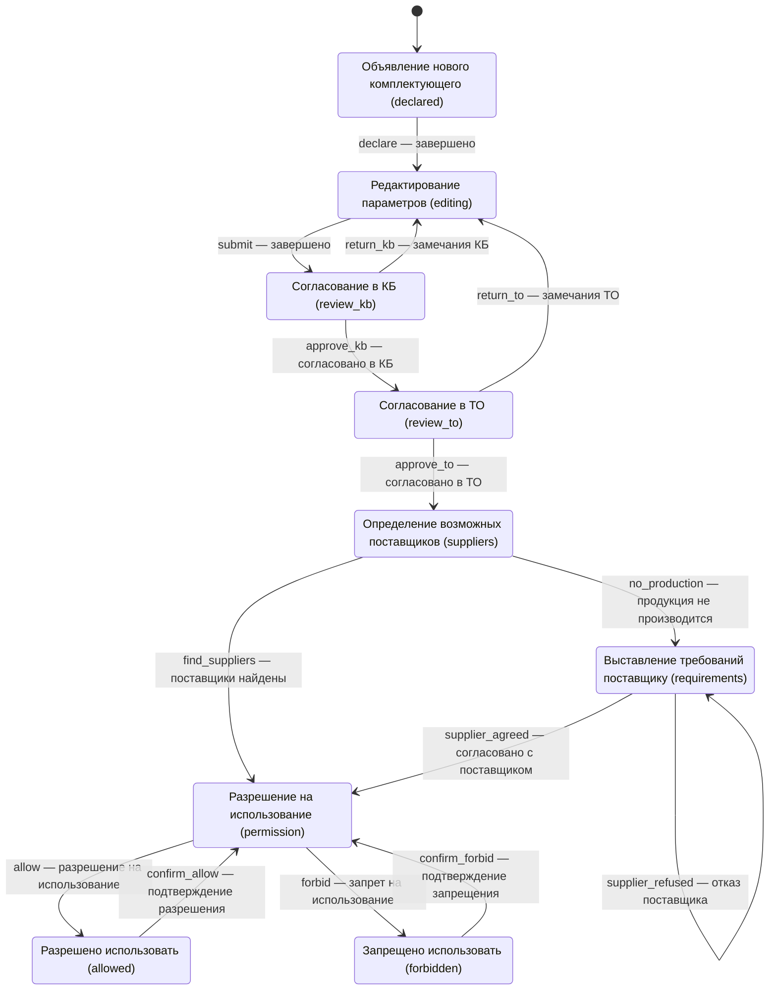
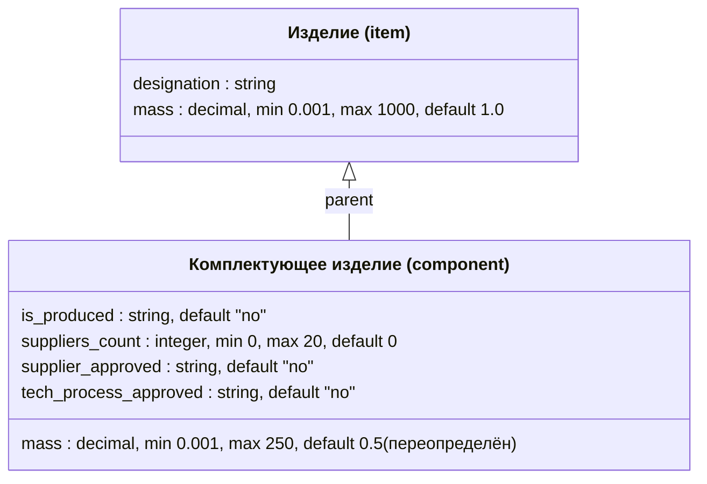
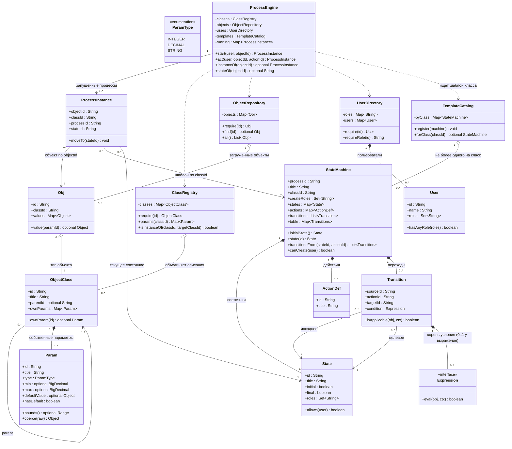

# Спецификация системы — Задание 3-1-1, Вариант 1

**Дисциплина:** Модели объектов и процессов информационных систем (ЛЭТИ)
**Вариант:** 1 — «Включение нового комплектующего в справочник» (рис. 1 задания)
**Класс объектов:** `component` — «Комплектующее изделие»
**Механизм объектной модели:** **только наследование параметров** (`parent` + полное переопределение параметра). Составность, пути `состав.параметр` и агрегаторы в данной реализации **не используются** (см. §10).
**Стек:** Java 25, Maven, Jackson YAML/JSON, JUnit 6.

Документ является **исходным заданием для этапа разработки** (`developer`), тестирования (`tester-qa`) и основой раздела «Устройство системы» отчёта.

---

## 1. Задание, вариант и реализуемые механизмы

Система описывает и исполняет процессы над объектами предметной области на основе **конфигурируемых моделей**:

| Требование задания (§2) | Как реализуется |
|---|---|
| Описание классов, параметров и готовых объектов в конфигурации | `config/classes.yaml`, `config/objects.yaml`, `config/users.yaml` |
| Шаблон процесса: состояния, действия, переходы, роли, ДНФ-условия | `config/process.yaml` |
| Экземпляр процесса по шаблону, привязанному к классу объекта | `ProcessEngine.start`, точное совпадение `class` шаблона и класса объекта |
| Исполнение с проверкой действия, роли и условия | `ProcessEngine.act`, табличный автомат + Интерпретатор |
| Механизм объектной модели: **наследование параметров** | `parent: item` у класса `component`, переопределение `mass` |
| Регистрация всех команд в JSONL-журнале | `ProcessService.send` → `AuditLog` (`JsonLinesLog`, `MemoryLog`) |
| Проверка работоспособности на примере | `config/demo.yaml`, §7, §8 |

Схема «Модели отделены от механизма исполнения» соблюдается буквально: **в Java-коде нет ни одного** идентификатора класса, состояния, действия, роли, параметра или предиката варианта 1. Всё перечисленное приходит из YAML.

### 1.1. Демонстрируемые механизмы наследования

1. **Базовый класс** `item` («Изделие») — общие параметры `designation`, `mass`.
2. **Подкласс** `component` («Комплектующее изделие», `parent: item`):
   * **наследует** параметр `designation` без изменений;
   * **полностью переопределяет** параметр `mass`: другой диапазон (`max: 250` вместо `1000`) и другое значение по умолчанию (`0.5` вместо `1.0`);
   * **добавляет** собственные параметры `is_produced`, `suppliers_count`, `supplier_approved`, `tech_process_approved`.
3. **Проверка наследования в работе**: объект `cmp-heavy` с `mass: 320` **допустим** для класса `item` (≤ 1000), но **недопустим** для `component` (≤ 250) — переход `submit` отклоняется предикатом `mass_in_range`, который берёт диапазон из **действующего** (после переопределения) описания параметра.
4. **Предикат класса** `is_item` (`class_id: item`) истинен для объекта класса `component`, поскольку `component` — подкласс `item`. Это единственное место, где наследование влияет на логику перехода.

> **Важно.** Шаблон процесса **не наследуется**: он привязан к точному классу `component`, поэтому объект `itm-1` класса `item` процесса не имеет, и команда `start` для него отклоняется.

---

## 2. Описание процесса варианта 1

### 2.1. Диаграмма состояний



Диаграмма полностью повторяет рис. 1 задания. **Конечных состояний нет**: `allowed` и `forbidden` — «результатные» состояния, из которых доступно действие подтверждения, возвращающее в `permission` (как в исходной диаграмме). Это допустимо по §2.1 задания («конечных состояний может быть несколько или не быть»). Результат процесса — состояние `allowed` либо `forbidden`.

### 2.2. Состояния и роли

| Состояние | Название | Роли, выполняющие действия | Особенности |
|---|---|---|---|
| `declared` | Объявление нового комплектующего | `developer` | **начальное**, ровно одно |
| `editing` | Редактирование параметров | `developer` | сюда возвращают `return_kb`, `return_to` |
| `review_kb` | Согласование в КБ | `kb` | |
| `review_to` | Согласование в ТО | `to` | |
| `suppliers` | Определение возможных поставщиков | `omts` | |
| `requirements` | Выставление требований поставщику | `omts` | есть переход в себя |
| `permission` | Разрешение на использование | `chief_designer` | |
| `forbidden` | Запрещено использовать | `chief_designer` | результат, не конечное |
| `allowed` | Разрешено использовать | `chief_designer` | результат, не конечное |

`create_roles: [developer]` — процесс над объектом может запустить только пользователь с ролью `developer`.

### 2.3. Действия

| Действие | Название | Переходы |
|---|---|---|
| `declare` | Завершить объявление | `declared → editing` |
| `submit` | Завершить редактирование и передать в КБ | `editing → review_kb` |
| `return_kb` | Вернуть с замечаниями КБ | `review_kb → editing` |
| `approve_kb` | Согласовать в КБ | `review_kb → review_to` |
| `return_to` | Вернуть с замечаниями ТО | `review_to → editing` |
| `approve_to` | Согласовать в ТО | `review_to → suppliers` |
| `find_suppliers` | Поставщики найдены | `suppliers → permission` |
| `no_production` | Продукция не производится | `suppliers → requirements` |
| `supplier_refused` | Отказ поставщика | `requirements → requirements` |
| `supplier_agreed` | Согласовано с поставщиком | `requirements → permission` |
| `allow` | Разрешить использование | `permission → allowed` |
| `forbid` | Запретить использование | `permission → forbidden` |
| `confirm_allow` | Подтвердить разрешение | `allowed → permission` |
| `confirm_forbid` | Подтвердить запрещение | `forbidden → permission` |

Названия действий — **данные конфигурации**, отдельными Java-классами не являются (Command `Action` хранит `action` как строку).

### 2.4. Предикаты

| Предикат | Параметр / класс | Оператор | Операнд | Смысл |
|---|---|---|---|---|
| `designation_filled` | `designation` | `filled` | — | обозначение задано |
| `mass_in_range` | `mass` | `in_range` | — | масса в диапазоне **действующего** описания `component` (0.001–250) |
| `mass_le_10` | `mass` | `<=` | `10` | масса не более 10 кг (лёгкое изделие) |
| `is_item` | класс `item` | — (предикат класса) | — | объект принадлежит `item` **или его подклассу** |
| `produced` | `is_produced` | `=` | `"yes"` | продукция серийно производится |
| `supplier_approved` | `supplier_approved` | `=` | `"yes"` | поставщик согласован |
| `tech_approved` | `tech_process_approved` | `=` | `"yes"` | технология изготовления согласована |
| `has_suppliers` | `suppliers_count` | `>=` | `1` | найден хотя бы один возможный поставщик |

Требование §3 задания «показать ИЛИ, И, `not` и проверку диапазона» выполнено: `И` — в каждой группе, `ИЛИ` — между группами и в переходе `approve_to`, `not` — в `no_production`, `allow`, `forbid`, диапазон — `mass_in_range` и `mass_le_10`. Дополнительно показан **предикат класса** `is_item`, проверяющий принадлежность базовому классу `item`.

### 2.5. Переходы и условия в ДНФ

Форма записи условия: **список дизъюнктов** (между ними «ИЛИ»), каждый дизъюнкт — **список предикатов** (между ними «И»), перед предикатом может стоять `not`. Переход без `condition` разрешён всегда (`Always`).

| № | Из | Действие | В | Условие (ДНФ) | Логическая формула |
|---|---|---|---|---|---|
| 1 | `declared` | `declare` | `editing` | `[[designation_filled, is_item]]` | обозначение задано **И** объект является изделием |
| 2 | `editing` | `submit` | `review_kb` | `[[designation_filled, mass_in_range]]` | обозначение задано **И** масса в диапазоне |
| 3 | `review_kb` | `return_kb` | `editing` | — | всегда |
| 4 | `review_kb` | `approve_kb` | `review_to` | `[[designation_filled, mass_in_range]]` | обозначение задано **И** масса в диапазоне |
| 5 | `review_to` | `return_to` | `editing` | — | всегда |
| 6 | `review_to` | `approve_to` | `suppliers` | `[[tech_approved], [mass_le_10]]` | технология согласована **ИЛИ** изделие лёгкое |
| 7 | `suppliers` | `find_suppliers` | `permission` | `[[produced, has_suppliers]]` | производится **И** есть поставщики |
| 8 | `suppliers` | `no_production` | `requirements` | `[[not produced]]` | **НЕ** производится |
| 9 | `requirements` | `supplier_refused` | `requirements` | — | всегда (цикл) |
| 10 | `requirements` | `supplier_agreed` | `permission` | `[[supplier_approved]]` | поставщик согласован |
| 11 | `permission` | `allow` | `allowed` | `[[produced, has_suppliers], [not produced, supplier_approved]]` | (P **И** S) **ИЛИ** (**НЕ** P **И** A) |
| 12 | `permission` | `forbid` | `forbidden` | `[[not produced, not supplier_approved], [produced, not has_suppliers]]` | (**НЕ** P **И** **НЕ** A) **ИЛИ** (P **И** **НЕ** S) |
| 13 | `allowed` | `confirm_allow` | `permission` | — | всегда |
| 14 | `forbidden` | `confirm_forbid` | `permission` | — | всегда |

Обозначения: **P** — `produced`, **S** — `has_suppliers`, **A** — `supplier_approved`.

**Почему переходы 11 и 12 не неоднозначны.** Условие перехода 12 получено из условия 11 по законам де Моргана:

```
НЕ[(P И S) ИЛИ (НЕ P И A)] = (НЕ P ИЛИ НЕ S) И (P ИЛИ НЕ A)
                            = (НЕ P И НЕ A) ИЛИ (P И НЕ S)
```

Следовательно, при любых значениях параметров истинно **ровно одно** из условий, поэтому неоднозначность («подходят несколько переходов») в этой конфигурации не возникает. Общий механизм обязан её обнаруживать и сообщать об ошибке (§5.4).

Аналогично не пересекаются переходы 7 и 8 (`produced` и `not produced`), поэтому выбор перехода всегда однозначен.

---

## 3. Предметная модель (наследование параметров)

### 3.1. Классы и параметры



| Класс | Параметр | Тип | `min` | `max` | `default` | Происхождение |
|---|---|---|---|---|---|---|
| `item` | `designation` | `string` | — | — | нет | собственный |
| `item` | `mass` | `decimal` | 0.001 | 1000 | 1.0 | собственный |
| `component` | `designation` | `string` | — | — | нет | **унаследован** |
| `component` | `mass` | `decimal` | 0.001 | **250** | **0.5** | **переопределён** |
| `component` | `is_produced` | `string` | — | — | `"no"` | собственный |
| `component` | `suppliers_count` | `integer` | 0 | 20 | 0 | собственный |
| `component` | `supplier_approved` | `string` | — | — | `"no"` | собственный |
| `component` | `tech_process_approved` | `string` | — | — | `"no"` | собственный |

Правила (реализует `ClassRegistry`):

1. У класса не более одного родителя (`parent`), циклы запрещены.
2. Действующий набор параметров = параметры родителя (рекурсивно, с сохранением порядка объявления) + собственные параметры.
3. Собственный параметр с тем же `id` **полностью заменяет** унаследованный: `title`, `min`, `max`, `default` берутся из подкласса; **тип обязан совпадать** (проверка при загрузке).
4. Удалить унаследованный параметр нельзя.
5. Диапазон и `default` берутся **только из действующего описания** — поэтому `mass` у `component` ограничена 250, а не 1000.

### 3.2. Готовые объекты

| Объект | Класс | Значения | Назначение в демонстрации |
|---|---|---|---|
| `cmp-1` | `component` | `designation=АБВГ.757412.001`, `mass=0.35`, `is_produced="yes"`, `suppliers_count=3`, `tech_process_approved="yes"`; `supplier_approved` — по умолчанию `"no"` | основной маршрут до `allowed`, отказы по ролям и условию |
| `cmp-custom` | `component` | `designation=АБВГ.757412.002`, `mass=12.5`, `is_produced="no"`, `suppliers_count=0`, `supplier_approved="yes"`, `tech_process_approved="yes"` | маршрут «продукция не производится» с циклом на `requirements` |
| `cmp-heavy` | `component` | `designation=АБВГ.757412.003`, `mass=320`, `is_produced="yes"`, `suppliers_count=2`, `tech_process_approved="yes"` | **отказ по `in_range`**: 320 > 250 (но ≤ 1000 у базового `item`) |
| `cmp-undefined` | `component` | значения не заданы: `mass=0.5`, `is_produced="no"`, `suppliers_count=0`, `supplier_approved="no"`, `tech_process_approved="no"`, `designation=null` | **`default`** и **незаданное значение**: отказ по `designation_filled` |
| `cmp-explicit-null` | `component` | `designation=АБВГ.757412.004`, `mass=5.0`, `is_produced="yes"`, `suppliers_count: null`, `tech_process_approved="yes"` | **явный `null`** не заменяется `default`: `has_suppliers` ложно |
| `itm-1` | `item` | `designation=АБВГ.300000.001`, `mass=25.0` | нет шаблона для класса `item` → `start` отклоняется |

Правила загрузки (`ObjectRepository` + `ConfigurationLoader`):

* для каждого действующего параметра класса: если ключ **присутствует** в `values` — берётся значение как есть (в том числе `null`); если ключ **пропущен** и у параметра есть `default` — подставляется `default`; иначе `null`;
* значения приводятся к типу параметра: `integer → Long`, `decimal → BigDecimal`, `string → String`;
* границы `min`/`max` при загрузке **не проверяются** — только в предикатах;
* лишние ключи в `values` игнорируются (полная валидация входа не требуется).

### 3.3. Пользователи и роли

| Роль | Название | Пользователь |
|---|---|---|
| `developer` | Разработчик | `ivanov` (Иванов И. И.) |
| `kb` | Конструкторское бюро | `petrov` (Петров П. П.) |
| `to` | Технологический отдел | `sokolova` (Соколова А. В.) |
| `omts` | Отдел материально-технического снабжения | `kuznetsov` (Кузнецов Д. С.) |
| `chief_designer` | Главный конструктор | `sidorov` (Сидоров С. С.) — роли `[chief_designer, omts]` |

Для разрешения операции достаточно **одной** подходящей роли (у `sidorov` их две). Аутентификация не требуется: пользователь указывается в команде.

---

## 4. Конфигурация: полные YAML-файлы и схемы

Каталог `config/`. Все четыре обязательных файла плюс демонстрационный сценарий `demo.yaml`.

### 4.1. `config/classes.yaml`

```yaml
# Наследование параметров: у класса не более одного родителя (parent).
# Собственный параметр с тем же id ПОЛНОСТЬЮ заменяет описание родителя (тип обязан совпадать).
# default подставляется, только если поле пропущено в объекте; явный null сохраняется.
classes:
  - id: item
    title: Изделие
    parameters:
      - id: designation
        title: Обозначение
        type: string
      - id: mass
        title: Масса, кг
        type: decimal
        min: 0.001
        max: 1000
        default: 1.0

  - id: component
    title: Комплектующее изделие
    parent: item
    parameters:
      - id: mass # переопределение: другой диапазон и другое значение по умолчанию
        title: Масса, кг
        type: decimal
        min: 0.001
        max: 250
        default: 0.5
      - id: is_produced
        title: Продукция серийно производится
        type: string
        default: "no"
      - id: suppliers_count
        title: Число возможных поставщиков
        type: integer
        min: 0
        max: 20
        default: 0
      - id: supplier_approved
        title: Поставщик согласован
        type: string
        default: "no"
      - id: tech_process_approved
        title: Технология изготовления согласована
        type: string
        default: "no"
```

### 4.2. `config/objects.yaml`

```yaml
objects:
  - id: cmp-1
    class: component
    values:
      designation: АБВГ.757412.001
      mass: 0.35
      is_produced: "yes"
      suppliers_count: 3
      tech_process_approved: "yes"
      # supplier_approved не задан -> "no" по умолчанию

  - id: cmp-custom
    class: component
    values:
      designation: АБВГ.757412.002
      mass: 12.5
      is_produced: "no"
      suppliers_count: 0
      supplier_approved: "yes"
      tech_process_approved: "yes"

  - id: cmp-heavy # масса вне диапазона подкласса component (max 250), но в диапазоне item
    class: component
    values:
      designation: АБВГ.757412.003
      mass: 320
      is_produced: "yes"
      suppliers_count: 2
      tech_process_approved: "yes"

  - id: cmp-undefined # все значения по умолчанию; designation не задано
    class: component

  - id: cmp-explicit-null # явный null не заменяется значением по умолчанию
    class: component
    values:
      designation: АБВГ.757412.004
      mass: 5.0
      is_produced: "yes"
      suppliers_count: null
      tech_process_approved: "yes"

  - id: itm-1 # объект базового класса: шаблона для item нет
    class: item
    values:
      designation: АБВГ.300000.001
      mass: 25.0
```

### 4.3. `config/users.yaml`

```yaml
roles:
  - id: developer
    title: Разработчик
  - id: kb
    title: Конструкторское бюро
  - id: to
    title: Технологический отдел
  - id: omts
    title: Отдел материально-технического снабжения
  - id: chief_designer
    title: Главный конструктор

users:
  - id: ivanov
    name: Иванов И. И.
    roles: [developer]
  - id: petrov
    name: Петров П. П.
    roles: [kb]
  - id: sokolova
    name: Соколова А. В.
    roles: [to]
  - id: kuznetsov
    name: Кузнецов Д. С.
    roles: [omts]
  - id: sidorov
    name: Сидоров С. С.
    roles: [chief_designer, omts] # несколько ролей: прав больше
```

### 4.4. `config/process.yaml`

```yaml
process: component_catalog_entry
title: Включение нового комплектующего в справочник
class: component # шаблон привязан к ТОЧНОМУ классу; шаблоны не наследуются
create_roles: [developer]

actions:
  - id: declare
    title: Завершить объявление
  - id: submit
    title: Завершить редактирование и передать в КБ
  - id: return_kb
    title: Вернуть с замечаниями КБ
  - id: approve_kb
    title: Согласовать в КБ
  - id: return_to
    title: Вернуть с замечаниями ТО
  - id: approve_to
    title: Согласовать в ТО
  - id: find_suppliers
    title: Поставщики найдены
  - id: no_production
    title: Продукция не производится
  - id: supplier_refused
    title: Отказ поставщика
  - id: supplier_agreed
    title: Согласовано с поставщиком
  - id: allow
    title: Разрешить использование
  - id: forbid
    title: Запретить использование
  - id: confirm_allow
    title: Подтвердить разрешение
  - id: confirm_forbid
    title: Подтвердить запрещение

# Ровно одно из полей parameter / class_id.
predicates:
  - id: designation_filled
    parameter: designation
    operator: filled
  - id: mass_in_range
    parameter: mass
    operator: in_range
  - id: mass_le_10
    parameter: mass
    operator: '<='
    value: 10
  - id: is_item # предикат класса: объект класса item или его подкласса
    class_id: item
  - id: produced
    parameter: is_produced
    operator: '='
    value: "yes"
  - id: supplier_approved
    parameter: supplier_approved
    operator: '='
    value: "yes"
  - id: tech_approved
    parameter: tech_process_approved
    operator: '='
    value: "yes"
  - id: has_suppliers
    parameter: suppliers_count
    operator: '>='
    value: 1

states:
  - id: declared
    title: Объявление нового комплектующего
    initial: true
    roles: [developer]
  - id: editing
    title: Редактирование параметров
    roles: [developer]
  - id: review_kb
    title: Согласование в КБ
    roles: [kb]
  - id: review_to
    title: Согласование в ТО
    roles: [to]
  - id: suppliers
    title: Определение возможных поставщиков
    roles: [omts]
  - id: requirements
    title: Выставление требований поставщику
    roles: [omts]
  - id: permission
    title: Разрешение на использование
    roles: [chief_designer]
  - id: forbidden
    title: Запрещено использовать
    roles: [chief_designer]
  - id: allowed
    title: Разрешено использовать
    roles: [chief_designer]

# Условие: список дизъюнктов (ИЛИ), дизъюнкт — список предикатов (И), допускается "not <id>".
transitions:
  - from: declared
    action: declare
    to: editing
    condition:
      - [designation_filled, is_item] # И
  - from: editing
    action: submit
    to: review_kb
    condition:
      - [designation_filled, mass_in_range]
  - from: review_kb
    action: return_kb
    to: editing
  - from: review_kb
    action: approve_kb
    to: review_to
    condition:
      - [designation_filled, mass_in_range]
  - from: review_to
    action: return_to
    to: editing
  - from: review_to
    action: approve_to
    to: suppliers
    condition:
      - [tech_approved] # ИЛИ
      - [mass_le_10]
  - from: suppliers
    action: find_suppliers
    to: permission
    condition:
      - [produced, has_suppliers]
  - from: suppliers
    action: no_production
    to: requirements
    condition:
      - [not produced] # отрицание
  - from: requirements
    action: supplier_refused
    to: requirements # переход в себя
  - from: requirements
    action: supplier_agreed
    to: permission
    condition:
      - [supplier_approved]
  - from: permission # (P И S) ИЛИ (НЕ P И A)
    action: allow
    to: allowed
    condition:
      - [produced, has_suppliers]
      - [not produced, supplier_approved]
  - from: permission # дополнение предыдущего условия по де Моргану
    action: forbid
    to: forbidden
    condition:
      - [not produced, not supplier_approved]
      - [produced, not has_suppliers]
  - from: allowed
    action: confirm_allow
    to: permission
  - from: forbidden
    action: confirm_forbid
    to: permission
```

### 4.5. `config/demo.yaml` (воспроизводимая демонстрация)

```yaml
# Сценарий демонстрации: выполняется по порядку при запуске без аргументов.
commands:
  - {type: start,  user: ivanov,    object: cmp-1}
  - {type: action, user: ivanov,    object: cmp-1, action: declare}
  - {type: action, user: petrov,    object: cmp-1, action: submit}
  - {type: action, user: ivanov,    object: cmp-1, action: submit}
  - {type: action, user: petrov,    object: cmp-1, action: return_kb}
  - {type: action, user: ivanov,    object: cmp-1, action: submit}
  - {type: action, user: ivanov,    object: cmp-1, action: approve_kb}
  - {type: action, user: petrov,    object: cmp-1, action: approve_kb}
  - {type: action, user: sokolova,  object: cmp-1, action: approve_to}
  - {type: action, user: kuznetsov, object: cmp-1, action: find_suppliers}
  - {type: action, user: petrov,    object: cmp-1, action: allow}
  - {type: action, user: sidorov,   object: cmp-1, action: allow}
  - {type: action, user: sidorov,   object: cmp-1, action: confirm_allow}
  - {type: action, user: sidorov,   object: cmp-1, action: forbid}
  - {type: action, user: sidorov,   object: cmp-1, action: allow}

  - {type: start,  user: ivanov,    object: cmp-heavy}
  - {type: action, user: ivanov,    object: cmp-heavy, action: declare}
  - {type: action, user: ivanov,    object: cmp-heavy, action: submit}

  - {type: start,  user: ivanov,    object: cmp-undefined}
  - {type: action, user: ivanov,    object: cmp-undefined, action: declare}

  - {type: start,  user: ivanov,    object: cmp-custom}
  - {type: action, user: ivanov,    object: cmp-custom, action: declare}
  - {type: action, user: ivanov,    object: cmp-custom, action: submit}
  - {type: action, user: petrov,    object: cmp-custom, action: approve_kb}
  - {type: action, user: sokolova,  object: cmp-custom, action: approve_to}
  - {type: action, user: kuznetsov, object: cmp-custom, action: no_production}
  - {type: action, user: kuznetsov, object: cmp-custom, action: supplier_refused}
  - {type: action, user: kuznetsov, object: cmp-custom, action: supplier_agreed}
  - {type: action, user: sidorov,   object: cmp-custom, action: allow}
  - {type: action, user: sidorov,   object: cmp-custom, action: confirm_allow}

  - {type: start,  user: ivanov,    object: cmp-explicit-null}
  - {type: action, user: ivanov,    object: cmp-explicit-null, action: declare}
  - {type: action, user: ivanov,    object: cmp-explicit-null, action: submit}
  - {type: action, user: petrov,    object: cmp-explicit-null, action: approve_kb}
  - {type: action, user: sokolova,  object: cmp-explicit-null, action: approve_to}
  - {type: action, user: kuznetsov, object: cmp-explicit-null, action: find_suppliers}

  - {type: start,  user: ivanov,    object: itm-1}
  - {type: start,  user: ivanov,    object: cmp-1}
```

### 4.6. Схемы (формальное описание полей)

**`classes.yaml`**

| Путь | Тип | Обяз. | Правило |
|---|---|---|---|
| `classes` | list | да | список описаний классов |
| `classes[].id` | string | да | уникален |
| `classes[].title` | string | да | отображаемое имя |
| `classes[].parent` | string | нет | id существующего класса; без циклов; не более одного |
| `classes[].parameters` | list | нет | собственные параметры |
| `parameters[].id` | string | да | уникален в пределах класса |
| `parameters[].title` | string | да | |
| `parameters[].type` | `integer`\|`decimal`\|`string` | да | при переопределении должен совпадать с родительским |
| `parameters[].min` / `.max` | number | нет | только для числовых типов; незаданная граница не проверяется |
| `parameters[].default` | scalar по типу | нет | подставляется при **пропущенном** поле |

**`objects.yaml`**

| Путь | Тип | Обяз. | Правило |
|---|---|---|---|
| `objects[].id` | string | да | уникален |
| `objects[].class` | string | да | id существующего класса |
| `objects[].values` | dict | нет | `id параметра → значение`; `null` — допустимое явное значение |

**`users.yaml`**

| Путь | Тип | Обяз. | Правило |
|---|---|---|---|
| `roles[].id` / `.title` | string | да | уникальные id |
| `users[].id` / `.name` | string | да | уникальные id |
| `users[].roles` | list[string] | да | непустой список существующих ролей |

**`process.yaml`**

| Путь | Тип | Обяз. | Правило |
|---|---|---|---|
| `process` | string | да | идентификатор шаблона |
| `title` | string | да | |
| `class` | string | да | существующий класс; **не более одного шаблона на класс** |
| `create_roles` | list[string] | да | роли, дающие право `start` |
| `actions[].id` / `.title` | string | да | уникальные id |
| `predicates[].id` | string | да | уникален; на него ссылается `condition` |
| `predicates[].parameter` | string | ровно одно из двух | id параметра (проверяется по действующему описанию класса объекта) |
| `predicates[].class_id` | string | ровно одно из двух | предикат класса |
| `predicates[].operator` | enum §5.2 | да (для параметрического) | |
| `predicates[].value` | scalar | для `=`,`!=`,`<`,`<=`,`>`,`>=` | правый операнд |
| `predicates[].aggregate` | — | **запрещено** | присутствие → `ConfigurationException` (агрегаторы не поддерживаются) |
| `states[].id` / `.title` | string | да | `id` уникален |
| `states[].initial` | bool | нет | ровно у одного состояния `true` |
| `states[].final` | bool | нет | в этой конфигурации не используется |
| `states[].roles` | list[string] | да для неконечных | роли, которым разрешены действия в состоянии |
| `transitions[].from` / `.to` | string | да | id существующих состояний |
| `transitions[].action` | string | да | id существующего действия |
| `transitions[].condition` | list[list[string]] | нет | ДНФ; элемент — `id` предиката или `not <id>` |

**Ошибки загрузки** (`ConfigurationException`, fail-fast): отсутствует/дублируется `id`; неизвестная ссылка (`parent`, `class`, `roles`, `from/action/to`, предикат в условии); нет ровно одного начального состояния; у параметрического предиката одновременно `parameter` и `class_id` (или ни одного); тип переопределённого параметра не совпадает; два шаблона на один класс; присутствует `aggregate` или путь с точкой.

---

## 5. Устройство системы

### 5.1. Пакеты и классы

Базовый пакет `ru.etu.mopis`.

| Пакет | Классы | Ответственность |
|---|---|---|
| `ru.etu.mopis` | `Main` | разбор аргументов, запуск демонстрации из `demo.yaml`, вывод результата |
| `ru.etu.mopis.config` | `ConfigurationLoader`, `ConditionCompiler`, `ApplicationModel` | чтение YAML, сборка реестров, компиляция ДНФ в дерево выражений |
| `ru.etu.mopis.type` | `ParamType`, `Param`, `ObjectClass`, `ClassRegistry`, `Obj`, `ObjectRepository` | Type Object: описания типов, наследование параметров, готовые объекты |
| `ru.etu.mopis.user` | `User`, `UserDirectory` | роли и пользователи |
| `ru.etu.mopis.fsm` | `State`, `ActionDef`, `Transition`, `StateMachine`, `TemplateCatalog`, `ProcessInstance`, `ProcessEngine` | общие правила шаблона, состояние экземпляра, исполнение переходов |
| `ru.etu.mopis.expr` | `Expression`, `Or`, `And`, `Not`, `ParamPredicate`, `ClassPredicate`, `Always`, `EvalContext` | Интерпретатор условий |
| `ru.etu.mopis.command` | `Command`, `StartCommand`, `ActionCommand`, `CommandMessage`, `CommandResult`, `ProcessService` | Command: запрос → исполнение → результат |
| `ru.etu.mopis.audit` | `AuditLog`, `AuditEntry`, `JsonLinesLog`, `MemoryLog` | журнал JSONL, подменяемая реализация |
| `ru.etu.mopis.error` | `CommandOutcome`, `CommandException`, `RejectedException`, `AmbiguousTransitionException`, `ConfigurationException` | исходы и причины |

**Разделение «шаблон / экземпляр» (требование §4 задания).** `StateMachine`, `State`, `ActionDef`, `Transition`, `Param`, `ObjectClass` — **неизменяемые общие данные**, создаются один раз при загрузке. `ProcessInstance` — единственный носитель изменяемого состояния процесса (`stateId`). `ProcessEngine` хранит словарь `objectId → ProcessInstance`; шаблон текущее состояние **не содержит**.

Ключевые операции:

```java
// ru.etu.mopis.type
Map<String, Param> params(String classId)          // действующие параметры с учётом parent
boolean isInstanceOf(String classId, String target) // совпадение или подкласс (рефлексивно)

// ru.etu.mopis.fsm
ProcessInstance start(User user, String objectId)   // create_roles, точный класс, повторный запуск
ProcessInstance act(User user, String objectId, String actionId) // роль + ДНФ + однозначность
String stateOf(String objectId)                     // текущее состояние или null

// ru.etu.mopis.command
CommandResult send(CommandMessage message)          // единственная точка обработки и записи в журнал
```

### 5.2. Семантика предикатов и операторов

`Expression.eval(Obj obj, EvalContext ctx)` — булево значение; выражение **никогда не бросает** исключений из-за данных.

| Оператор | Операнд | Семантика | Значение `null` |
|---|---|---|---|
| `filled` | нет | значение задано; пустая строка — **задана** | `false` |
| `=` | `value` | строки — точное совпадение; числа — числовое равенство (`2` = `2.0`) | `false` |
| `!=` | `value` | отрицание `=`, но при `null` — `false` | `false` |
| `<`, `<=`, `>`, `>=` | число | числовое сравнение (`BigDecimal`) | `false` |
| `in_range` | нет | `min ≤ value ≤ max` по **действующему** описанию параметра; незаданная граница не проверяется; обе границы отсутствуют — `true`; нечисловой параметр — `false` | `false` |
| (предикат класса) | `class_id` | `ClassRegistry.isInstanceOf(obj.classId, class_id)` | — |

Правила:
* параметр, отсутствующий у класса объекта, и незаданное значение дают `false` **для любого** параметрического предиката, включая `filled`; `not` инвертирует уже полученный булев результат;
* `Always` (переход без условия) возвращает `true`;
* описание параметра берётся из **действующего** набора класса объекта, а не из класса, где параметр объявлен впервые.

### 5.3. Компиляция ДНФ

`ConditionCompiler.compile(condition)`:

```
condition: [[a, "not b"], [c]]   →   Or( And(a, Not(b)), And(c) )
condition отсутствует            →   Always
[[a]]                            →   And(a)   (допустимо и просто a)
```

Дерево строится **один раз при загрузке**; при каждой команде только вычисляется. Неизвестный `id` предиката → `ConfigurationException` («понятная ошибка, а не подмена»).

### 5.4. Обработка команды (путь по программе)

```
Main.main → читает demo.yaml или argv → CommandMessage{type, user, object, action}
   ↓
ProcessService.send(message)
   ├─ stateBefore = engine.stateOf(object)          // null, если объект неизвестен или процесс не запущен
   ├─ command = new StartCommand(engine, user, object) | new ActionCommand(engine, user, object, action)
   ├─ result  = command.execute()                   // → engine.start / engine.act
   └─ finally: audit.write(entry)                   // ОДНА запись на каждую команду
```

**`ProcessEngine.start(user, object)`** — проверки по порядку:

1. пользователь существует, иначе `RejectedException("пользователь не найден")`;
2. объект существует, иначе `RejectedException("объект не найден")`;
3. в каталоге есть шаблон **точно** для класса объекта, иначе `RejectedException("нет шаблона процесса для класса …")`;
4. у пользователя есть одна из `create_roles`, иначе `RejectedException("требуется роль …")`;
5. процесс над объектом ещё не создан, иначе `RejectedException("процесс уже запущен")`;
6. создаётся `ProcessInstance(objectId, classId, processId, initialState.id)`.

**`ProcessEngine.act(user, object, action)`** — проверки по порядку:

1. пользователь существует, иначе `RejectedException`;
2. объект существует и процесс запущен, иначе `RejectedException("процесс не запущен")`;
3. экземпляр не в конечном состоянии, иначе отказ (в данной конфигурации конечных состояний нет, правило общее);
4. действие объявлено в шаблоне, иначе `RejectedException("неизвестное действие")`;
5. роль пользователя допустима в **текущем состоянии** (`State.roles`), иначе `RejectedException("требуется роль …")`;
6. `candidates = table[(state, action)]`; если пусто, `RejectedException("нет перехода по действию …")`;
7. `matched = candidates where condition.eval(obj, ctx) == true`:
   * `0`: `RejectedException("условие перехода не выполнено")`;
   * `> 1`: `AmbiguousTransitionException("неоднозначный переход: …")` (исход `error`);
   * `1`: **единственная мутация** — `instance.moveTo(target)`.

Состояние изменяется **только** на шаге 7 при единственном совпадении. Любое исключение до этого оставляет `stateId` неизменным — требование «отказ не меняет состояние» выполняется по построению.

Порядок диагностики при нескольких нарушениях заданием не фиксируется; приведённый порядок принят для воспроизводимости тестов.

### 5.5. Журнал (JSONL)

`ProcessService` — **единственная точка** записи. На каждую обработанную команду (успех, отказ, ошибка) ровно одна строка в `logs/audit.jsonl`.

Формат записи (порядок полей фиксирован):

```json
{"command":{"type":"action","user":"sidorov","object":"cmp-1","action":"allow"},"user":"sidorov","object":"cmp-1","state_before":"permission","state_after":"allowed","result":"accepted","reason":null}
```

| Поле | Смысл |
|---|---|
| `command` | исходная команда: `type` (`start`/`action`), `user`, `object`, `action` (только для `action`) |
| `user`, `object` | значения из команды |
| `state_before` | состояние до обработки; `null`, если процесса не было (успешный `start`, неизвестный объект, отказ `start`) |
| `state_after` | состояние после обработки; при отказе совпадает с `state_before` |
| `result` | `accepted` \| `rejected` \| `error` |
| `reason` | причина отказа/ошибки; `null` при успехе |

Правила:
* `start` принят → `state_before: null`, `state_after: "declared"`;
* повторный `start` → оба поля содержат текущее состояние процесса;
* `JsonLinesLog` открывает файл в режиме **перезаписи** при старте приложения и пишет по строке на команду с `flush()`;
* `MemoryLog` хранит `List<AuditEntry>` и используется в тестах — обработчик при этом не меняется (внедрение зависимости через конструктор).

### 5.6. Результат команды для вызывающей стороны

`CommandResult{ outcome, stateBefore, stateAfter, reason, message }`; `Main` печатает строку вида:

```
[1] start ivanov cmp-1 -> accepted | declared   (состояние: null -> declared)
[3] action petrov cmp-1 submit -> rejected | editing   (требуется роль developer)
```

---

## 6. Диаграммы классов программы

### 6.1. Данные предметной области и конечный автомат



Пояснения к диаграмме:

* `Obj` **агрегирует** общее описание типа: несколько объектов используют один `ObjectClass`. `parent` — ссылка на описание родителя в **данных**, а не наследование Java-классов.
* `ObjectClass` **владеет** только собственными объявлениями `Param`; унаследованные остаются у родителя, а `ClassRegistry.params()` собирает действующий набор.
* `StateMachine` **владеет** состояниями, действиями и переходами (композиция) и **не хранит** текущее состояние. Экземпляр и переходы **ссылаются** на состояния.
* `Transition.condition` — собственный корень выражения (`Always`, если условие не задано); вложенные предикаты могут использоваться совместно в разных переходах.

### 6.2. Интерпретатор, команды, журнал и загрузка

```mermaid
classDiagram
    direction TB

    class Expression {
        <<interface>>
        +eval(obj, ctx) boolean
    }

    class Or {
        +items : List~Expression~
        +eval(obj, ctx) boolean
    }

    class And {
        +items : List~Expression~
        +eval(obj, ctx) boolean
    }

    class Not {
        +inner : Expression
        +eval(obj, ctx) boolean
    }

    class ParamPredicate {
        +paramId : String
        +operator : String
        +operand : optional Object
        +eval(obj, ctx) boolean
    }

    class ClassPredicate {
        +targetClassId : String
        +eval(obj, ctx) boolean
    }

    class Always {
        +eval(obj, ctx) boolean
    }

    class EvalContext {
        +classes : ClassRegistry
        +objects : ObjectRepository
    }

    class Command {
        <<interface>>
        +execute() CommandResult
    }

    class StartCommand {
        -engine : ProcessEngine
        +userId : String
        +objectId : String
        +execute() CommandResult
    }

    class ActionCommand {
        -engine : ProcessEngine
        +userId : String
        +objectId : String
        +actionId : String
        +execute() CommandResult
    }

    class CommandMessage {
        +type : String
        +userId : String
        +objectId : String
        +actionId : optional String
    }

    class CommandResult {
        +outcome : CommandOutcome
        +stateBefore : optional String
        +stateAfter : optional String
        +reason : optional String
    }

    class ProcessService {
        -engine : ProcessEngine
        -audit : AuditLog
        +send(message) CommandResult
    }

    class AuditLog {
        <<interface>>
        +write(entry) void
    }

    class JsonLinesLog {
        -path : Path
        -mapper : ObjectMapper
        +write(entry) void
    }

    class MemoryLog {
        -entries : List~AuditEntry~
        +write(entry) void
        +entries() List~AuditEntry~
    }

    class AuditEntry {
        +command : dict
        +user : String
        +object : String
        +stateBefore : optional String
        +stateAfter : optional String
        +result : CommandOutcome
        +reason : optional String
        +toJson(mapper) dict
    }

    class CommandOutcome {
        <<enumeration>>
        ACCEPTED
        REJECTED
        ERROR
    }

    class CommandException {
        +outcome : CommandOutcome
        +reason : String
    }

    class RejectedException
    class AmbiguousTransitionException
    class ConfigurationException

    class ConfigurationLoader {
        +load(configDir) ApplicationModel
    }

    class ConditionCompiler {
        -predicates : Map~Expression~
        +compile(condition) Expression
    }

    class ApplicationModel {
        +classes : ClassRegistry
        +objects : ObjectRepository
        +users : UserDirectory
        +templates : TemplateCatalog
    }

    class Main {
        +main(args) void
        +runScript(commands) void
    }

    Or --|> Expression
    And --|> Expression
    Not --|> Expression
    ParamPredicate --|> Expression
    ClassPredicate --|> Expression
    Always --|> Expression

    Or "1" o-- "1..*" Expression : дизъюнкты ИЛИ
    And "1" o-- "1..*" Expression : конъюнкты И
    Not "1" o-- "1" Expression : отрицаемый элемент

    ParamPredicate ..> EvalContext : значение и описание параметра
    ClassPredicate ..> EvalContext : принадлежность классу

    StartCommand ..|> Command
    ActionCommand ..|> Command
    StartCommand "0..*" --> "1" ProcessEngine : получатель
    ActionCommand "0..*" --> "1" ProcessEngine : получатель

    ProcessService "1" --> "1" AuditLog : внедрённый журнал
    ProcessService ..> CommandMessage : разбирает
    ProcessService ..> Command : создаёт
    ProcessService ..> CommandResult : возвращает
    ProcessService ..> CommandException : перехватывает и журналирует
    Command ..> CommandResult
    Command ..> CommandException : порождает

    JsonLinesLog ..|> AuditLog
    MemoryLog ..|> AuditLog
    AuditLog ..> AuditEntry
    JsonLinesLog ..> AuditEntry

    CommandException <|-- RejectedException
    CommandException <|-- AmbiguousTransitionException
    CommandResult --> CommandOutcome
    CommandException --> CommandOutcome

    ConfigurationLoader ..> ConditionCompiler
    ConfigurationLoader ..> ApplicationModel
    ConfigurationLoader ..> Expression : создаёт предикаты
    ConditionCompiler ..> Expression : строит дерево ДНФ
    Main ..> ConfigurationLoader
    Main ..> ProcessService
    Main ..> JsonLinesLog
```



### 6.3. Как читать диаграммы

* **Поток команды:** `Main → CommandMessage → ProcessService.send → Command(Start|Action).execute → ProcessEngine.start/act → Transition.isApplicable → Expression.eval → CommandResult → AuditLog.write`.
* **Выбор перехода:** `StateMachine.transitionsFrom(state, action)` возвращает кандидатов; роль проверяется по `State.roles`; условия — деревом выражений; при единственном `true` выполняется `ProcessInstance.moveTo`.
* **Подмена журнала:** `ProcessService` зависит от интерфейса `AuditLog`; в тестах передаётся `MemoryLog`, в демонстрации — `JsonLinesLog` с потоком `logs/audit.jsonl`.
* **Добавление нового перехода/состояния/предиката не требует изменения Java-кода** — только `process.yaml`.

---

## 7. Демонстрационный сценарий

Все команды выполняются по порядку, по одной записи журнала на команду. «До → после» — значения `state_before` → `state_after` в журнале.

| № | Пользователь | Объект | Команда | Результат | До → после | Причина / сработавшее условие |
|:-:|---|---|---|---|---|---|
| 1 | ivanov | cmp-1 | start | accepted | null → declared | роль `developer` в `create_roles` |
| 2 | ivanov | cmp-1 | declare | accepted | declared → editing | `designation_filled И is_item` |
| 3 | petrov | cmp-1 | submit | rejected | editing → editing | требуется роль `developer` |
| 4 | ivanov | cmp-1 | submit | accepted | editing → review_kb | `designation_filled И mass_in_range` |
| 5 | petrov | cmp-1 | return_kb | accepted | review_kb → editing | **возврат на предыдущий этап** (без условия) |
| 6 | ivanov | cmp-1 | submit | accepted | editing → review_kb | повторная передача в КБ |
| 7 | ivanov | cmp-1 | approve_kb | rejected | review_kb → review_kb | требуется роль `kb` |
| 8 | petrov | cmp-1 | approve_kb | accepted | review_kb → review_to | условие выполнено |
| 9 | sokolova | cmp-1 | approve_to | accepted | review_to → suppliers | `tech_approved` (первый дизъюнкт) |
| 10 | kuznetsov | cmp-1 | find_suppliers | accepted | suppliers → permission | `produced И has_suppliers` (3 поставщика) |
| 11 | petrov | cmp-1 | allow | rejected | permission → permission | требуется роль `chief_designer` |
| 12 | sidorov | cmp-1 | allow | accepted | permission → allowed | `(P И S) ИЛИ (НЕ P И A)` — первая группа |
| 13 | sidorov | cmp-1 | confirm_allow | accepted | allowed → permission | без условия |
| 14 | sidorov | cmp-1 | forbid | rejected | permission → permission | условие `forbid` ложно (дополнение `allow`) |
| 15 | sidorov | cmp-1 | allow | accepted | permission → allowed | **результат процесса: `allowed`** |
| 16 | ivanov | cmp-heavy | start | accepted | null → declared | |
| 17 | ivanov | cmp-heavy | declare | accepted | declared → editing | |
| 18 | ivanov | cmp-heavy | submit | rejected | editing → editing | **`in_range`**: 320 > `max` подкласса (250) |
| 19 | ivanov | cmp-undefined | start | accepted | null → declared | |
| 20 | ivanov | cmp-undefined | declare | rejected | declared → declared | `designation_filled` ложно (`designation = null`) |
| 21 | ivanov | cmp-custom | start | accepted | null → declared | |
| 22 | ivanov | cmp-custom | declare | accepted | declared → editing | |
| 23 | ivanov | cmp-custom | submit | accepted | editing → review_kb | масса 12.5 в диапазоне |
| 24 | petrov | cmp-custom | approve_kb | accepted | review_kb → review_to | |
| 25 | sokolova | cmp-custom | approve_to | accepted | review_to → suppliers | `tech_approved` |
| 26 | kuznetsov | cmp-custom | no_production | accepted | suppliers → requirements | **`not produced`** |
| 27 | kuznetsov | cmp-custom | supplier_refused | accepted | requirements → requirements | переход в себя |
| 28 | kuznetsov | cmp-custom | supplier_agreed | accepted | requirements → permission | `supplier_approved` |
| 29 | sidorov | cmp-custom | allow | accepted | permission → allowed | **вторая группа**: `not produced И supplier_approved` |
| 30 | sidorov | cmp-custom | confirm_allow | accepted | allowed → permission | **результат: `allowed`** |
| 31 | ivanov | cmp-explicit-null | start | accepted | null → declared | |
| 32 | ivanov | cmp-explicit-null | declare | accepted | declared → editing | |
| 33 | ivanov | cmp-explicit-null | submit | accepted | editing → review_kb | |
| 34 | petrov | cmp-explicit-null | approve_kb | accepted | review_kb → review_to | |
| 35 | sokolova | cmp-explicit-null | approve_to | accepted | review_to → suppliers | |
| 36 | kuznetsov | cmp-explicit-null | find_suppliers | rejected | suppliers → suppliers | `suppliers_count: null` → `has_suppliers` ложно |
| 37 | ivanov | itm-1 | start | rejected | null → null | нет шаблона для класса `item` (точное совпадение) |
| 38 | ivanov | cmp-1 | start | rejected | allowed → allowed | процесс уже запущен (повторный запуск) |

Итог: **29 принятых** и **9 отклонённых** команд, 38 записей журнала.

### 7.1. Фрагмент `logs/audit.jsonl`

```json
{"command":{"type":"start","user":"ivanov","object":"cmp-1"},"user":"ivanov","object":"cmp-1","state_before":null,"state_after":"declared","result":"accepted","reason":null}
{"command":{"type":"action","user":"petrov","object":"cmp-1","action":"submit"},"user":"petrov","object":"cmp-1","state_before":"editing","state_after":"editing","result":"rejected","reason":"требуется роль developer в состоянии editing"}
{"command":{"type":"action","user":"sidorov","object":"cmp-1","action":"allow"},"user":"sidorov","object":"cmp-1","state_before":"permission","state_after":"allowed","result":"accepted","reason":null}
{"command":{"type":"action","user":"kuznetsov","object":"cmp-explicit-null","action":"find_suppliers"},"user":"kuznetsov","object":"cmp-explicit-null","state_before":"suppliers","state_after":"suppliers","result":"rejected","reason":"условие перехода не выполнено"}
{"command":{"type":"start","user":"ivanov","object":"itm-1"},"user":"ivanov","object":"itm-1","state_before":null,"state_after":null,"result":"rejected","reason":"нет шаблона процесса для класса item"}
```

Точные тексты `reason` спецификацией не фиксируются (кроме требований «понятно» и «непусто»); тесты проверяют `result`, `state_before`, `state_after` и непустой `reason` у отказов.

### 7.2. Запуск

```bash
mvn clean compile
mvn exec:java                                   # выполняет config/demo.yaml, пишет logs/audit.jsonl
mvn exec:java -Dexec.args="start ivanov cmp-1"  # одна команда из argv
mvn test
```

Отдельные команды из argv позволяют продемонстрировать любой шаг вручную; демонстрация из `demo.yaml` воспроизводима и не содержит предметных данных в Java-коде.

---

## 8. Обязательные тестовые сценарии (для `tester-qa`)

| ID | Сценарий | Вход | Ожидание |
|---|---|---|---|
| T1 | Основной маршрут до результата | `demo.yaml` №1–15 (`cmp-1`) | итоговое состояние `allowed`; приняты команды №1,2,4,5,6,8–10,12,13,15; отклонены №3,7,11,14; 15 записей журнала |
| T2 | Возврат на предыдущий этап | №5 `return_kb`, а также `return_to` на `cmp-1`-подобном объекте | `review_kb → editing` (`review_to → editing`), состояние изменилось, запись `accepted` |
| T3 | Отказ по роли | №3 (petrov `submit` в `editing`), №7 (ivanov `approve_kb`), №11 (petrov `allow`) | `result = rejected`, `state_before == state_after`, состояние процесса не изменилось |
| T4 | Отказ по условию | №18 (`cmp-heavy` `submit`), №20 (`cmp-undefined` `declare`), №36 (`cmp-explicit-null` `find_suppliers`) | `rejected`, состояние не изменилось, `reason` непустой |
| T5 | Наследование и переопределение | `cmp-heavy` (`mass 320`), `itm-1` | 320 вне диапазона `component` (≤250), но в диапазоне `item` (≤1000) → `submit` отклонён; `itm-1` не имеет шаблона → `start` отклонён |
| T6 | `default` и явный `null` | `cmp-undefined`, `cmp-explicit-null` | `cmp-undefined`: `mass = 0.5`, `is_produced = "no"`, `designation = null`; `cmp-explicit-null`: `suppliers_count = null` (не 0) |
| T7 | Предикат класса | `cmp-1` на переходе `declare` | `is_item` истинен для `component` (подкласс `item`) → переход выполнен |
| T8 | Повторный запуск | №38 | `rejected`, `state_before == state_after == allowed` |
| T9 | Неоднозначный переход (опционально) | тестовый YAML с двумя переходами, чьи условия истинны | `result = error`, состояние не изменилось |
| T10 | Журнал | все команды | на каждую команду ровно одна строка JSONL; поля `command`, `user`, `object`, `state_before`, `state_after`, `result`, `reason`; файл парсится Jackson; `MemoryLog.entries().size()` равно числу команд |

Тесты используют `MemoryLog` (без файла) и `JsonLinesLog` с временным файлом (`@TempDir`); состояние процесса проверяется через `ProcessEngine.stateOf(...)`.

---

## 9. Трассировка требований задания

| Пункт задания | Где реализовано |
|---|---|
| §2.1 классы, параметры, `min`/`max`/`default` | `config/classes.yaml`, `Param`, `ObjectClass` |
| §2.1 наследование (`parent`, переопределение) | `ClassRegistry.params`, `isInstanceOf`; `mass` у `component` |
| §2.1 `default` только для пропущенных полей | `ConfigurationLoader` (`containsKey` → `null` сохраняется) |
| §2.1 пользователи и роли, «достаточно одной роли» | `User`, `UserDirectory`, `User.hasAnyRole` |
| §2.1 один шаблон на класс, точное совпадение `class` | `TemplateCatalog`, `ProcessEngine.start` (шаг 3) |
| §2.1 одно начальное состояние, роли состояний | `StateMachine.initialState`, `State.roles` |
| §2.2 операторы `filled`, `=`, `!=`, `<`, `<=`, `>`, `>=`, `in_range` | `ParamPredicate` (§5.2) |
| §2.2 предикат класса | `ClassPredicate` + `ClassRegistry.isInstanceOf` |
| §2.2 ДНФ, `not`, переход без условия | `ConditionCompiler`, `Or`/`And`/`Not`/`Always` |
| §2.2 незаданное значение → `false` | `ParamPredicate.eval` (проверка `null` первой) |
| §2.3 `start` и `action`, причины отказа | `StartCommand`, `ActionCommand`, `ProcessEngine` |
| §2.3 неоднозначность → ошибка, состояние не меняется | `AmbiguousTransitionException` (шаг 7 `act`) |
| §2.4 запись каждой команды, JSONL, поля | `ProcessService.send`, `AuditEntry`, `JsonLinesLog` |
| §2.4 отказ не меняет состояние | единственная мутация — `ProcessInstance.moveTo` |
| §3 вариант 1, роли по этапам, И/ИЛИ/`not`/диапазон | §2.1–§2.5, `config/process.yaml` |
| §5 паттерны: Type Object, FSM, Interpreter, Command, Strategy*, DI | §5.1, §6 (`*` Strategy не требуется без составности) |
| §5.6 единая точка логирования, внедрение `AuditLog` | `ProcessService(engine, auditLog)`, `MemoryLog` в тестах |

---

## 10. Границы реализации и принятые решения

1. **Только наследование.** Составность, пути `состав.параметр`, `quantity_min`/`quantity_max` и агрегаторы не реализуются (§2.2 задания: «при выборе наследования без составности пути и агрегаторы не требуются»). Если в конфигурации встретится `aggregate` или путь с точкой, загрузчик обязан выдать **понятную ошибку** `ConfigurationException`, а не молча применить другой алгоритм (§2.1).
2. **Конечных состояний нет** — так на рис. 1: `allowed` и `forbidden` имеют исходящие переходы подтверждения. Результат процесса — одно из этих состояний. Правило «из конечного состояния действия не выполняются» реализуется общим кодом (`State.final`) и в этой конфигурации не активируется.
3. **Строки вместо булевых значений.** Типы параметров ограничены `integer|decimal|string` (§2.1), поэтому признаки заданы строками `"yes"`/`"no"`. Значения **обязательно заключать в кавычки**: в YAML 1.1 (`no`, `yes`, `on`, `off`) без кавычек превращаются в булевы.
4. **Диапазон `mass` у подкласса — 250, а не 1000.** Это осознанная демонстрация переопределения: объект `cmp-heavy` (320 кг) проходит проверку для `item`, но не проходит для `component`.
5. **`allow` и `forbid` — дополнения по де Моргану**, поэтому неоднозначности нет; механизм её обнаружения всё равно реализуется и покрывается отдельным (необязательным) тестом.
6. **Порядок диагностики** зафиксирован в §5.4 для воспроизводимости тестов; задание порядок не регламентирует.
7. **Журнал** перезаписывается при старте приложения; восстановление процессов из журнала не выполняется (§2.4).
8. **Сценарий демонстрации — данные** (`config/demo.yaml`), а не код: в `Main` нет идентификаторов варианта.
9. **Без сторонних логгеров** (SLF4J/Logback): журнал — собственная реализация `AuditLog` на Jackson.
